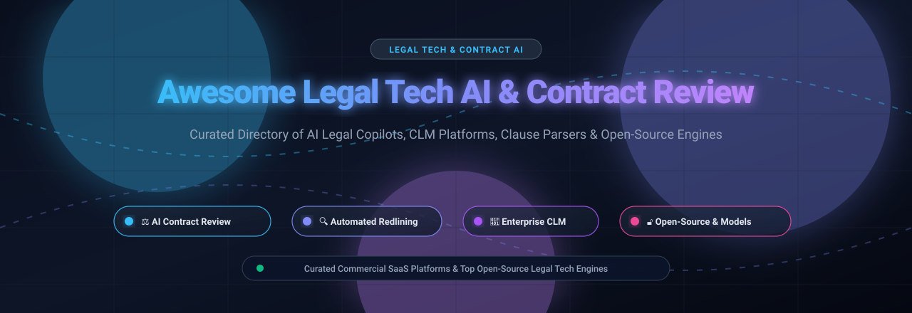

  

# ⚖️ Awesome-Legal-Tech-AI-Contract-Review 🤖

  
  
  
  
  
  

> 🌟 **Top Legal Tech AI Contract Review & Contract Lifecycle Management (CLM)**: A comprehensive, SEO-optimized curated directory of enterprise AI legal copilots, automated redlining engines, smart contract lifecycle management suites, legal NLP datasets, and self-hosted open-source software (FOSS) tools. 🌟

---

## 📑 Table of Contents

- [📊 Sector Overview & Market Dynamics](#-sector-overview--market-dynamics)
- [🏢 SaaS/Hosted Platforms](#-saashosted-platforms)
- [🔓 Open-Source Equivalents & Tools](#-open-source-equivalents--tools)
  - [🤖 AI Contract Review, Drafting & Legal Copilots](#-ai-contract-review-drafting--legal-copilots)
  - [📋 Open-Source Contract Lifecycle Management (CLM) & E-Signature](#-open-source-contract-lifecycle-management-clm--e-signature)
  - [📑 Legal Document Automation & Clause Markup Standards](#-legal-document-automation--clause-markup-standards)
  - [🧠 Legal NLP Models, Datasets & Compliance Frameworks](#-legal-nlp-models-datasets--compliance-frameworks)
  - [📚 Self-Hosted Legal Research, Case Management & Practice Tools](#-self-hosted-legal-research-case-management--practice-tools)
- [📈 Star History](#-star-history)
- [💖 Support & Community](#-support--community)
- [🤝 Contributing](#-contributing)

---

## 📊 Sector Overview & Market Dynamics

The global Legal Tech software market is estimated at **$24B to $35B** (projected to exceed **$65B+ by 2032**), with the dedicated Contract Lifecycle Management (CLM) and AI contract review sub-segment valued at **$1.8B to $2.2B** and expanding at a CAGR of 12%–14%.

Market structure is **structurally fragmented with rapid platform consolidation**: while over 150+ regional vendors and specialized legal GenAI point-solutions compete for niche workflows, market dynamics are shifting toward concentration as enterprise legal departments abandon point-solution fatigue in favor of unified end-to-end CLM platforms and incumbents execute aggressive M&A landgrabs (e.g., DocuSign acquiring Lexion, Workday acquiring Evisort).

---

## 🏢 SaaS/Hosted Platforms

Commercial, cloud-hosted AI legal copilots, enterprise Contract Lifecycle Management (CLM) suites, and proprietary contract review platforms. *Sorted descending by company size (valuation / revenue).*

| Platform | Valuation / Revenue | Description | Starting Pricing | Free Tier / Trial Limits |
| --- | --- | --- | --- | --- |
| **[Thomson Reuters CoCounsel](https://thomsonreuters.com)** | **$7.0B+ Revenue** (Public: NYSE: TRI, ~$75B+ Market Cap) | Professional-grade generative AI legal assistant for contract analysis, legal research, deposition prep, and document review. | Starts at ~$100 – $225/user/month (add-on) or bundled starting at ~$630/month (CoCounsel Legal) | **Sales-assisted free trial** (duration typically 7 to 14 days upon representative approval). |
| **[Ironclad](https://ironcladapp.com)** | **$3.2B Valuation** (~$200M+ ARR) | Enterprise digital contracting and CLM platform featuring AI-assisted redlining, automated approval workflows, and repository analytics. | Starts at ~$500/month (base entry contracts typically start at $15,000/year) | **Sandbox evaluation period** available upon sales request for prospective enterprise testing; no public free plan. |
| **[Spellbook](https://spellbook.legal)** | **$350M Valuation** (Series B, ~$100M ARR target) | Generative AI contract drafting and review assistant integrated directly inside Microsoft Word for instant clause suggestions. | Starts at ~$89 – $179/user/month (billed annually) for standard professional tiers; solo tiers ~$249–$299/month | **7-day free trial** with full Microsoft Word add-in features (sales demo or sign-up activation). |
| **[SpotDraft](https://spotdraft.com)** | **$380M Valuation** ($113M total funding, ~$12.6M+ Revenue) | End-to-end cloud CLM platform built for fast-growing business and legal teams with automated templates and redline tracking. | Starts at ~$1,250 – $2,000/month (annual commitments starting at $15,000 – $25,000/year) | **No self-serve free tier or trial** (access via guided product demo only). |
| **[Evisort (Workday)](https://evisort.com)** | **$311M Valuation** (Acquired by Workday for $311M) | Enterprise contract intelligence and lifecycle platform using proprietary AI to extract metadata and clauses across legacy agreements. | Starts at ~$1,250 – $2,500/month (annual contracts starting at $15,000 – $30,000/year for up to 2,000 contracts) | **No self-serve free tier or trial** (guided enterprise proof of concept / pilot upon request). |
| **[ContractPodAi (Leah)](https://contractpodai.com)** | **$170M+ Funding** (~$45M – $58M ARR) | Commercial AI-powered CLM and legal GenAI platform automating contract generation, risk scoring, and obligation tracking. | Starts at ~$4,150/month (annual enterprise deployments starting at $50,000/year) | **No self-serve free tier or trial** (custom sales demonstration only). |
| **[Lexion (DocuSign IAM)](https://lexion.ai)** | **$165M Valuation** (Acquired by DocuSign for $165M) | AI-powered contract management and intake system automating redlines, renewals, and agreement workflows. | Starts at ~$1,250 – $2,100/month (annual contracts starting at $15,000 – $25,000+/year) | **No self-serve free tier or trial** (custom interactive demo provided upon request). |
| **[Luminance](https://luminance.com)** | **$165M Total Funding** ($75M Series C, UK AI leader) | Legal-grade AI platform automating contract negotiation, due diligence, and anomaly detection across multilingual documents. | Starts at ~$5,000/month (annual enterprise deployments starting at $60,000/year) | **No self-serve free tier or trial** (structured enterprise pilot / proof of concept negotiated with sales). |
| **[LawGeex](https://lawgeex.com)** | **$41.5M Funding** (~$8.8M – $22M Historic Revenue) | Commercial AI contract review automation platform comparing incoming agreements against predefined corporate legal playbooks. | Starts at ~$850 – $2,500/month (annual enterprise contracts typically starting at $10,000 – $30,000/year) | **No self-serve free tier or trial** (custom enterprise evaluation / demo only). |
| **[Robin AI](https://robinai.com)** | **$38M+ Funding** (~$6M ARR / Restructured) | AI-native contract copilot and managed legal service combining generative AI with human-in-the-loop contract drafting and review. | Free tier available; paid Pro tiers typically require quote / starting ~$250/mo | **Free forever plan:** 1 user, light usage capped at 10 messages/day. |

---

## 🔓 Open-Source Equivalents & Tools

Free and open-source software (FOSS) AI contract analyzers, open-source CLM & e-signature platforms, legal NLP models, and document assembly engines. *Within each section, repositories are sorted descending by GitHub Stars_Count.*

### 🤖 AI Contract Review, Drafting & Legal Copilots

* **[Docling](https://github.com/docling-project/docling)**  - State-of-the-art open-source layout-aware document parser engineered for complex legal tables, contracts, and PDFs, widely integrated with Ollama and vLLM for local contract redlining.
* **[Mike (Open Legal Products)](https://github.com/open-legal-products/mike)**  - Production-ready open-source AI legal platform for contract intelligence, document review, and legal case management.
* **[OpenContracts](https://github.com/Open-Source-Legal/OpenContracts)**  - Free, enterprise-grade open-source document analytics, legal clause annotation, and LLM-powered legal extraction platform.
* **[Prism Legal OS](https://github.com/FuturixAI-and-Quantum-Works/Prism-Legal-OS)**  - Open-source legal AI operating system for automated contract analysis, legal research, and corporate litigation support.
* **[Doc-Haus](https://github.com/sure-scale/doc-haus)**  - Local, privacy-first legal AI agent where contracts stay on local storage and redlines arrive directly inside Microsoft Word as native tracked changes.
* **[Draft Legal](https://github.com/AniketTati/draft-legal)**  - Open-source self-hosted alternative to Ironclad and Harvey providing AI-native contract lifecycle management and private drafting.
* **[LexGPT](https://github.com/jiehsheng/LexGPT)**  - Self-hosted, air-gapped open-source document Q&A and contract analysis stack guaranteeing complete attorney-client privilege.
* **[LawGlance](https://github.com/Ranit2004a/Law-Glance)**  - Open-source AI legal assistant built with Retrieval-Augmented Generation (RAG) and LLMs for instant legal Q&A and document breakdown.

### 📋 Open-Source Contract Lifecycle Management (CLM) & E-Signature

* **[DocuSeal](https://github.com/docusealco/docuseal)**  - Fast, lightweight open-source document signing and automated form-filling platform for self-hosted contract execution.
* **[Documenso](https://github.com/documenso/documenso)**  - Leading open-source DocuSign alternative offering self-hosted electronic signatures, legal templates, and cryptographic audit trails.
* **[OpenSign](https://github.com/OpenSignLabs/OpenSign)**  - Free, open-source legally binding electronic signature solution featuring tamper-proof PDF signing and developer APIs.
* **[Open-PDF-Sign](https://github.com/open-pdf-sign/open-pdf-sign)**  - Open-source command-line tool and Java library for cryptographically signing PDF contracts with hardware security modules (HSM) and smart cards.
* **[Accord Project](https://github.com/accordproject/template-archive)**  - Linux Foundation open-source framework for smart legal agreements, machine-readable clauses, and computable contract logic (Cicero & Ergo).

### 📑 Legal Document Automation & Clause Markup Standards

* **[Docxtemplater](https://github.com/open-xml-templating/docxtemplater)**  - High-performance template engine generating dynamic `.docx` and `.pptx` agreements from JSON data with conditional clauses, loops, and automated redlining.
* **[Catala](https://github.com/CatalaLang/catala)**  - Domain-specific formal programming language designed to translate complex statutory law and contract conditions into mathematically verified executable code.
* **[Docassemble](https://github.com/jhpyle/docassemble)**  - Free, open-source expert system for guided web interviews and automated assembly of complex legal documents (DOCX, PDF) powered by Python and YAML.
* **[Common Form](https://github.com/commonform-archive/commonform)**  - Open-source legal markup format and collaborative repository for modular, version-controlled contract drafting and clause standardisation.

### 🧠 Legal NLP Models, Datasets & Compliance Frameworks

* **[CUAD (Contract Understanding Atticus Dataset)](https://github.com/The-Atticus-Project/cuad)**  - Curated benchmark dataset of 500+ commercial legal agreements with 13,000+ expert annotations across 41 clause categories for legal NLP fine-tuning.
* **[LexGLUE](https://github.com/coastalcph/lex-glue)**  - Standardized legal natural language understanding benchmark suite for evaluating contract classification, statutory interpretation, and legal reasoning.
* **[Legal-BERT](https://huggingface.co/nlpaueb/legal-bert-base-uncased)** - Domain-adapted BERT transformer model pre-trained specifically on legislation, court filings, and corporate contracts for legal entity recognition and classification.
* **[SaulLM-7B / SaulLM-54B](https://huggingface.co/Equall/SaulLM-7B)** - Open-weights Large Language Model series tailored explicitly for legal contract comprehension, clause synthesis, and regulatory reasoning.
* **[Pile of Law](https://huggingface.co/datasets/pile-of-law/pile-of-law)** - 256GB open-source corpus of legal and administrative texts designed for pretraining privacy-conscious legal language models.

### 📚 Self-Hosted Legal Research, Case Management & Practice Tools

* **[Paperless-ngx](https://github.com/paperless-ngx/paperless-ngx)**  - Enterprise-grade self-hosted document management system with OCR, tag indexing, and automated archive retention workflows for legal filings.
* **[CourtListener](https://github.com/freelawproject/courtlistener)**  - Searchable open-source legal research repository and PACER aggregator indexing millions of court opinions, oral arguments, and docket filings.
* **[Juriscraper](https://github.com/freelawproject/juriscraper)**  - Free Law Project scraper library extracting court opinions, oral arguments, and docket data from hundreds of American federal and state courts.

---

## 📈 Star History

---

## 💖 Support & Community

Thank you so much for exploring and using **Awesome-Legal-Tech-AI-Contract-Review**! If you find this directory valuable for your legal technology research, contract automation, or software architecture decisions:

- ⭐ **Star** this repository to show your appreciation and help other developers/attorneys find it.
- 🍴 **Fork** it to build upon or maintain your own internal legal ops checklist.
- 📢 **Share** with your network across Twitter/X, LinkedIn, and legal tech communities.
- ☕ **Buy a Coffee / Sponsor**: Consider supporting ongoing maintenance on the [GitHub Sponsor Dashboard](https://github.com/sponsors/ishandutta2007).

---

## 🤝 Contributing

Contributions are warmly welcome! Whether you are an open-source maintainer, legal tech engineer, or legal ops professional, feel free to submit a pull request:

1. 🍴 Fork this repository.
2. ✍️ Add your project under the appropriate category with an accurate description, GitHub Stars_Badge (if open-source), and starting pricing / free-tier details (if SaaS).
3. 🚀 Submit a Pull Request.
